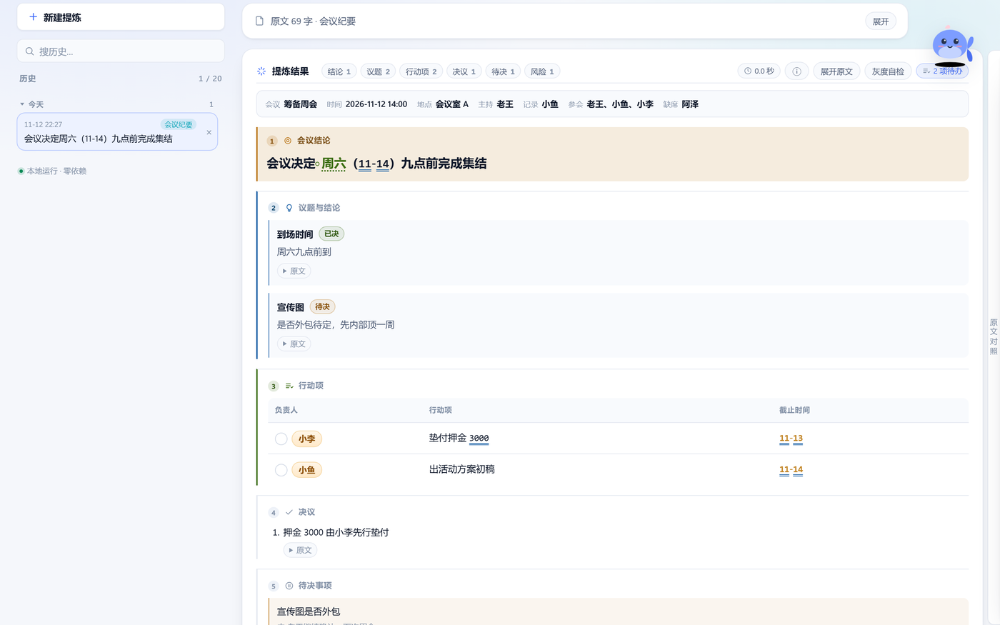
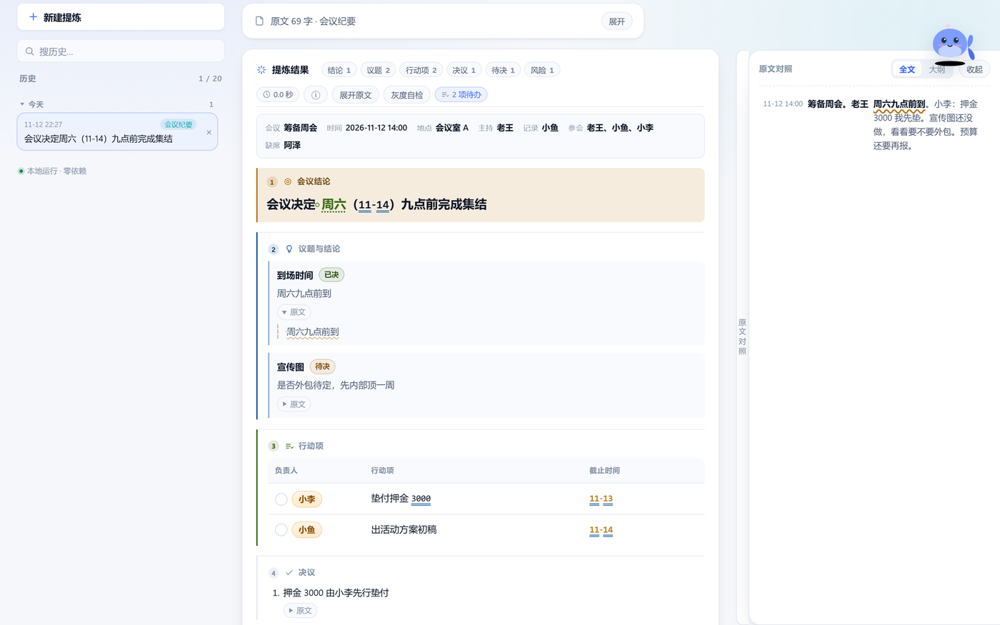
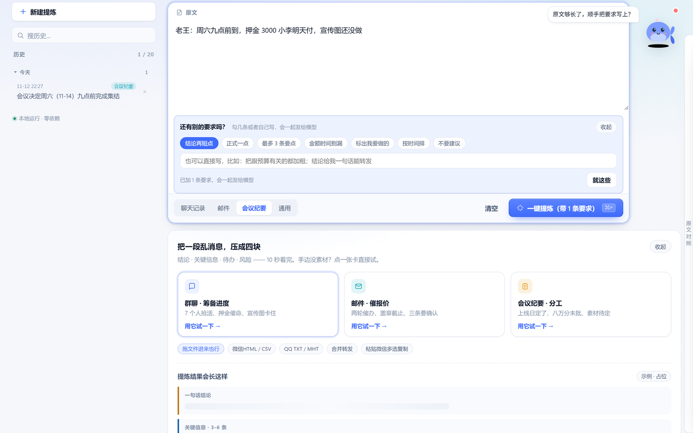

# 鲸汐提炼器 · 消息重点提取

把一段乱糟糟的消息，压成**结论 · 关键信息 · 待办 · 风险**四块卡片，10 秒看完。
粘聊天记录、拖微信/QQ 导出文件、贴通知公文都行，还能对着原文提问。

纯前端 · 零依赖 · 零构建 · 双击就能用 · 可安装成 App（PWA）· 也有 Windows 桌面版

> 本工具不内置任何 API Key。你在设置里填自己的 [DeepSeek](https://platform.deepseek.com/) Key，它只存在你浏览器本地。



## 它能做什么

| 能力 | 说明 |
|---|---|
| **四种内容类型，四种不同产出** | 聊天记录 → 聊天要点（谁答应了什么、谁还没回）；邮件 → 邮件摘要（抬头 + 需回复的问题）；会议纪要 → 纪要体（议题结论 + 行动项 + 决议 + 待决事项）；通用文本 → 通用提炼 |
| **提炼前先问要求** | 输入原文后桌宠会问「还有别的要求吗」，勾选或自己写，要求会真的写进提示词 |
| **每条都有原文依据** | 每条要点可展开看原文摘句；右侧「原文对照」抽屉可整段核对，命中句用波浪线标出 |
| **四种标记，灰度也认得出** | 高亮块 / 波浪线 + ▲ / 双下划线 / 虚线下划线，黑白打印、截图转灰都不丢信息 |
| **导入导出** | 认微信 HTML/CSV/TXT、QQ TXT/MHT、合并转发；导出 卡片.md、待办.csv、日历.ics、原文.txt |
| **桌宠小鲸汐** | 贴在输入框右边，能读原文、回答问题，还能换形象（上传自己的图，支持 GIF） |
| **历史 / 主题 / 快捷键** | 最近 20 条本地历史，可分组折叠、可删；深浅色主题；`Ctrl/⌘ + Enter` 快速提炼 |





## 快速开始

### 方式一：直接用

1. 下载本仓库（`Code → Download ZIP`）或 Releases 里的分享包
2. 解压，双击 `index.html`（Chrome / Edge）
3. 右上角钥匙图标 → 填 DeepSeek API Key → 保存
4. 粘一段聊天记录 → 选类型 → 一键提炼

### 方式二：本地起服务（能安装成 App）

```bash
npm run serve       # 等价于 python -m http.server 8000
# 打开 http://localhost:8000
```

### 方式三：在线用

用 GitHub Pages 部署后（见下），打开 `https://<用户名>.github.io/<仓库名>/`，
Chrome / Edge 地址栏右侧会出现「安装」图标 → 装成独立窗口的 App，**离线也能打开**。

### 方式四：Windows 桌面版（exe）

不想每次找浏览器、不想把 Key 存在浏览器里，就用桌面版：独立窗口、任务栏图标、窗口大小会记住，数据落在软件自己的配置目录（`%APPDATA%\鲸汐提炼器\`）。

- 成品：到 [Releases](../../releases) 下 `鲸汐提炼器-<版本>-便携版.exe`（单文件，双击即开）或 `-安装版.exe`
- 界面里能用的东西桌面版都有：右键复制/粘贴、`Ctrl+P` 打印卡片、`Ctrl+=` 缩放、拖文件、导出另存为、桌宠上传形象
- 觉得哪里不对，菜单「帮助 → 运行自检」会用假数据点一遍主要按钮（不花 API 额度），跑完自动还原你的数据，并给出一份报告
- 自己打包：

```bash
cd desktop
npm install
npm run dist        # 出便携版 + 安装版到 desktop/dist/
```

网页本体还是仓库根这一份，`desktop/` 只是 Electron 外壳，打包前会把根目录文件复制进去，两边永远同源。细节、自测脚本和打包踩坑见 [`desktop/README.md`](desktop/README.md)。

## 部署

仓库自带 workflow：[`.github/workflows/pages.yml`](.github/workflows/pages.yml)。

1. 推到 GitHub
2. 仓库 `Settings → Pages → Source` 选 **GitHub Actions**
3. 每次 push 到 `main` 自动发布

想让朋友直接用、又不想让他们自己申请 Key，看 [`deploy/README.md`](deploy/README.md)：
里面给了 Cloudflare Worker、nginx、PHP 三种「服务端代填 Key」的成品代码。

## 项目结构

```
index.html                 页面骨架
style.css                  全部样式（两套主题 + 组件）
app.js                     主流程：提炼、渲染、历史、抽屉、桌宠、PWA
parse.js                   导入解析：微信 / QQ / 合并转发 + 覆盖度守卫
tone.js                    语气与身份推断（本地规则，可选）
prompts.js                 四类提示词（想调效果改这里）
parsers/merged-forward.js  合并转发识别
manifest.webmanifest       PWA 清单
sw.js                      离线缓存
assets/                    图标与截图
deploy/                    部署方案与后端代理示例
docs/                      使用说明（pdf/docx/md）、开发日志、笔记
scripts/                   打包分享版的小工具
desktop/                   Windows 桌面版（Electron 外壳，网页本体不复制）
```

## 开发

没有构建步骤，改完刷新即可。只有两件事值得注意：

- 提示词全在 `prompts.js`，改这里调效果，不用碰 `app.js`
- 改了 `sw.js` 缓存的资源，记得把里面的 `CACHE` 版本号 +1，否则用户会拿到旧缓存

```bash
npm run serve     # 本地预览
npm run pack      # 打包分享版 zip 到 dist/
```

## 隐私

- 不上传任何数据：历史、Key、标记、桌宠形象全部存在本机（浏览器 localStorage；桌面版存在 `%APPDATA%\鲸汐提炼器\`）
- 只有你粘贴 / 导入的原文会发给 DeepSeek（提炼与提问都需要）
- 没有统计、埋点、第三方脚本，没有 CDN 依赖

## 已知限制

- 需要自备 DeepSeek API Key（工具本身免费）
- 微信「多选 → 合并转发」复制出来只有一张卡片，得双击打开再 `Ctrl+A`，或用 MemoTrace 导出文件
- 纯前端没有系统级权限：导出走浏览器下载 / 另存为，不能静默写进指定文件夹
- `file://` 双击打开时没有「安装 / 离线」，想要这两项需要一个 http(s) 地址


## 文档

- 用户手册：[docs/manual.pdf](docs/manual.pdf) · [Markdown 版](docs/manual.md)
- 开发日志（逐步做了什么、踩过哪些坑）：[docs/devlog.md](docs/devlog.md)
- 前端「效果」学习笔记：[docs/frontend-notes.md](docs/frontend-notes.md)
- 版本变更：[CHANGELOG.md](CHANGELOG.md) · 如何贡献：[CONTRIBUTING.md](CONTRIBUTING.md) · 安全说明：[SECURITY.md](SECURITY.md)

## 许可

[MIT](LICENSE)
